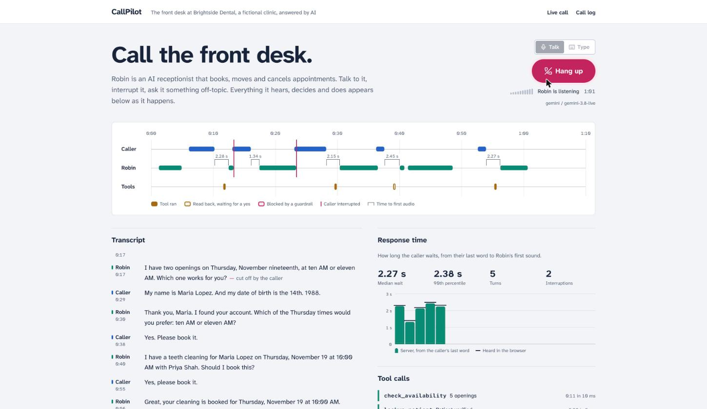
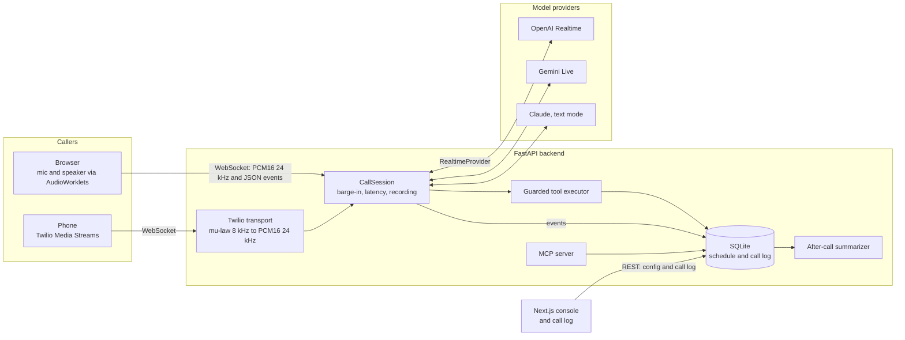

# CallPilot

**A real-time AI voice receptionist that answers calls in the browser or on a real phone line, books appointments through guarded tool calls, and stops talking the moment you interrupt.**

> **Demo GIF placeholder.** Record a call from the console, save it as `docs/media/demo.gif` and replace this note with ``.



<sub>A real voice call on the console. The caller lane shows when they spoke, Robin's lane when the agent was audible, raspberry lines where the caller cut in, and each bracket the wait before Robin answered.</sub>

CallPilot answers the phone for **Brightside Dental**, a fictional clinic. It is a portfolio project about the engineering a production voice agent needs:

- **Speech-to-speech in real time** over WebSockets, with OpenAI Realtime by default and Gemini Live behind the same provider interface (Claude handles text mode).
- **Barge-in**: talk over the agent and it stops within a few hundred milliseconds, and its memory is trimmed to what you actually heard.
- **Tool calling with guardrails enforced in code**: it can't offer a slot it didn't look up, act for an unverified caller, or book without your explicit yes.
- **Observability**: a live timeline of who spoke when, every tool call with its arguments and result, time-to-first-audio per turn, and an LLM-written summary of every call.
- **Phones too**: the same agent answers a real number through Twilio Media Streams.
- **Reusable tools**: the clinic tools are also an MCP server for other agents.

## Contents

- [Architecture](#architecture)
- [Measured latency](#measured-latency)
- [How barge-in works](#how-barge-in-works)
- [Guardrails](#guardrails)
- [Run it locally](#run-it-locally)
- [Development](#development)
- [Phone calls with Twilio](#phone-calls-with-twilio)
- [MCP server](#mcp-server)
- [Deploy to Google Cloud Run](#deploy-to-google-cloud-run)
- [Design decisions and trade-offs](#design-decisions-and-trade-offs)

## Architecture



One call is one `CallSession`. It forwards caller audio (or text) to a provider, runs every tool call the model makes through the guardrails, streams transcripts and tool activity back to the caller's screen, and appends everything to the call log as it happens. Everything inside the backend is PCM16 mono at 24 kHz; each edge converts to and from that.

| Path | What lives there |
| --- | --- |
| [`backend/src/callpilot/providers`](backend/src/callpilot/providers) | `RealtimeProvider` interface; OpenAI Realtime, Gemini Live, Claude and a scripted provider for tests |
| [`backend/src/callpilot/session`](backend/src/callpilot/session) | `CallSession`: barge-in, turn tracking, latency, recording |
| [`backend/src/callpilot/agent`](backend/src/callpilot/agent) | System prompt, per-call state and the guardrails |
| [`backend/src/callpilot/tools`](backend/src/callpilot/tools) | The five clinic tools and their schemas, rendered for each provider |
| [`backend/src/callpilot/transports`](backend/src/callpilot/transports) | Browser WebSocket and Twilio Media Streams |
| [`backend/src/callpilot/calllog`](backend/src/callpilot/calllog) | Call log queries, stats and LLM summaries |
| [`backend/src/callpilot/mcp_server.py`](backend/src/callpilot/mcp_server.py) | The clinic tools as an MCP server |
| [`frontend/`](frontend) | Next.js console and call log |
| [`infra/`](infra) | Terraform for Cloud Run |

## Measured latency

Measured with `make bench`. A synthetic caller speaks real audio into a live voice session in real time: 20 ms frames, pauses between sentences, and a client that plays the agent's audio at real speed and reports progress the way the browser does. Each run is three complete booking calls with one deliberate interruption. Raw results are in [`docs/benchmarks/`](docs/benchmarks).

**Time to first audio** runs from the caller's last voiced audio frame to the first audio frame of the reply leaving the server. It includes end-of-speech detection, the model and any tool calls.

| Gemini Live (`gemini-3.8-live`, free tier) | Turns | Median | p90 | Median, no tools | Median, with tools | End-of-speech detection (median) | Barge-in reaction |
| --- | ---: | ---: | ---: | ---: | ---: | ---: | ---: |
| 500 ms silence window (default) | 17 | **1.59 s** | 2.67 s | 1.31 s | 2.09 s | 0.94 s | 216–255 ms |
| 250 ms silence window | 15 | 1.76 s | 2.74 s | 1.39 s | 2.50 s | 0.76 s | 223–261 ms |

What the numbers say:

- **Most of the wait is the model deciding the caller has finished**, not the model thinking: about 0.94 s of a 1.59 s median.
- **A shorter silence window didn't help end to end.** Halving it cut detection by about 180 ms, but overall latency didn't improve within this sample, and shorter windows cut callers off at pauses. The default stays at 500 ms (`GEMINI_SILENCE_MS`).
- **A tool call costs about 0.8 s.** That is one extra model round trip; the tools themselves answer in under 10 ms.
- **Barge-in is fast.** The agent stops 216–261 ms after the caller starts talking over it, across six interruptions.
- **The browser agrees with the server.** In browser calls on localhost, what the caller heard was 16–52 ms behind the server's number (median 33 ms). Over a real network, add the round trip.
- Turns where the caller was still talking when the agent started (the model answered at a mid-sentence pause) are flagged and excluded rather than counted as instant replies.

Not measured here: OpenAI Realtime (no key was available; set `OPENAI_API_KEY` and run `make bench`). Text mode on Claude Opus 5.5 took about 5 s per turn in two browser calls, but that was not a benchmark run.

## How barge-in works

The caller should be able to cut the agent off mid-sentence, and the agent should behave as if it was really cut off.

1. **Detect.** The provider's voice activity detection reports that the caller started speaking (`input_audio_buffer.speech_started` on OpenAI, `voice_activity` or `interrupted` on Gemini). The agent goes quiet about 250 ms after the caller starts talking (see [Measured latency](#measured-latency)).
2. **Decide.** `CallSession` only treats it as a barge-in if the agent is still audible: either a response is streaming, or audio already sent is still queued on the caller's side. The browser and Twilio both report playback progress (the browser every 100 ms; Twilio by echoing a `mark` sent after each chunk), so the session knows the difference between "the agent is talking" and "the agent finished a second ago".
3. **Stop the audio.** The transport drops everything queued: the browser's playback worklet empties its buffer, and Twilio gets a `clear` message.
4. **Cancel and trim.** The provider cancels the in-flight response. On OpenAI the session also sends `conversation.item.truncate` with the milliseconds the caller actually heard, so the model's memory of its own turn matches the conversation. Gemini cancels generation itself and keeps its own record.
5. **Record.** The cut-off sentence is kept in the transcript marked as interrupted, a `barge_in` event lands on the timeline, and the next caller turn starts.

Echo cancellation is on in the browser (`getUserMedia({ echoCancellation: true })`), so the agent's own voice coming out of the speakers doesn't interrupt itself.

## Guardrails

The prompt asks the agent to stay on clinic topics, never invent availability and confirm before booking. The rules that matter are also enforced in [`agent/guardrails.py`](backend/src/callpilot/agent/guardrails.py), between the model and the database, so a model that ignores its prompt still can't do damage:

| Rule | How it is enforced |
| --- | --- |
| Never invent availability | `book_appointment` only accepts a `slot_id` that `check_availability` returned on this call |
| Identity first | Booking or cancelling needs a patient verified by name and date of birth on this call, and only their own appointments |
| Confirm before writing | Writes are two-step: the first call parks the request and returns a read-back; the second only succeeds if the arguments match and the caller has spoken since the read-back |
| No identity guessing | After three failed lookups the agent is told to hand the call to a person |
| Database integrity | A partial unique index makes double-booking impossible even under concurrent calls |

Every decision is visible: a parked write shows as "Read back, waiting for a yes" on the timeline and in the tool log, and a blocked call shows the rule that stopped it.

## Run it locally

You need Docker and at least one model key. Gemini has a free tier, which is enough for voice calls.

```sh
git clone https://github.com/GillParm/callpilot.git && cd callpilot
cp .env.example .env    # add GEMINI_API_KEY (free at aistudio.google.com/apikey) and/or other keys
docker compose up --build
```

Open <http://localhost:3000> and press **Call the front desk**. If ports 3000 or 8000 are taken, run `WEB_PORT=3100 API_PORT=8100 docker compose up --build`.

| Key | Enables |
| --- | --- |
| `GEMINI_API_KEY` | Voice calls with Gemini Live (free tier) and call summaries |
| `OPENAI_API_KEY` | Voice and text calls with the OpenAI Realtime API (used first for voice when set) |
| `ANTHROPIC_API_KEY` | Text calls and call summaries with Claude |

Try it as one of the made-up patients on file, for example **Maria Lopez, born March 14, 1988**, who already has a cleaning booked that you can move or cancel. The console lists the others.

## Development

```sh
make hooks          # pre-commit hook that blocks committed secrets
make dev-backend    # API on :8000 with reload (needs uv)
make dev-frontend   # web app on :3000 with hot reload (needs Node 24)
make check          # everything CI runs: lint, types, tests
```

**Tests.** `make test` runs the backend suite offline, with no keys or network. It covers:

- the tools and guardrails;
- conversation state and barge-in;
- the providers' event mapping;
- the Twilio bridge and the MCP server;
- a scripted **simulated caller** that books an appointment end to end through the real session, tools, database and call log.

The frontend has Vitest tests for the call state reducer and call replay. CI also runs ruff, mypy (strict), ESLint, Prettier, tsc, a secret scan, `terraform validate` and both Docker builds.

Two more test paths need keys:

- `make test-live` runs the simulated caller against real models: the configured agent talks to a second model playing the patient, and the test checks outcomes, not wording.
- `make bench` measures voice latency with a synthetic caller (macOS `say`), as described above.

## Phone calls with Twilio

1. Expose the backend over HTTPS (a Cloud Run deploy, or `ngrok http 8000` locally) and set `PUBLIC_BASE_URL` to that URL.
2. Set `TWILIO_AUTH_TOKEN` so webhooks are signature-checked.
3. In the Twilio console, point your number's voice webhook to `POST {PUBLIC_BASE_URL}/twilio/voice`.

The webhook returns TwiML that connects the call to `/twilio/media` with the caller's number and a signed, 60-second stream token, so nobody else can open a session on your API keys. The bridge converts 8 kHz mu-law to and from 24 kHz PCM and uses `mark` and `clear` for barge-in.

## MCP server

The five clinic tools are also an MCP server, so other agents can check availability or book through the same rules and database:

```sh
cd backend
uv run callpilot-mcp                     # stdio
uv run callpilot-mcp --http --port 8001  # streamable HTTP at http://127.0.0.1:8001/mcp
```

For an MCP client that launches servers over stdio:

```json
{
  "mcpServers": {
    "callpilot-clinic": {
      "command": "uv",
      "args": ["--directory", "/path/to/callpilot/backend", "run", "callpilot-mcp"]
    }
  }
}
```

Read-only tools are annotated as such, and `cancel_appointment` is marked destructive. Agents get the domain rules (real slots, the patient's own appointments). The spoken read-back and confirmation are left to the calling agent, since there is no caller on the line.

## Deploy to Google Cloud Run

[`infra/`](infra) has Terraform for two Cloud Run services (API and web app), Artifact Registry, Secret Manager and a least-privilege service account for each service. Secret values are added with `gcloud` so they never reach Terraform state. The short version:

```sh
cd infra && cp terraform.tfvars.example terraform.tfvars   # set project_id
terraform init
terraform apply -target=google_artifact_registry_repository.images -target=google_secret_manager_secret.keys
printf '%s' "$GEMINI_API_KEY" | gcloud secrets versions add GEMINI_API_KEY --data-file=-
# build and push linux/amd64 images, then:
terraform apply
```

See [infra/README.md](infra/README.md) for every step.

## Design decisions and trade-offs

**Speech-to-speech instead of a speech-to-text, LLM, text-to-speech cascade.** One model hears tone and timing, starts talking sooner (one hop instead of three) and handles interruptions natively. The cost is less control: you can't swap the transcriber or the voice independently, and transcripts come from the provider's own recognizer, sometimes a moment late. Text mode uses Claude, where the extra reasoning matters more than a voice.

**A small provider interface instead of a framework.** About ten event types and seven methods (`connect`, `greet`, `send_audio`, `send_text`, `send_tool_result`, `interrupt`, `close`). Each adapter absorbs its provider's quirks: OpenAI reports speech start and stop and supports truncation; Gemini cancels its own generation, tracks playback time on the server and has no truncate; Claude has no audio at all. The session never branches on which provider it is talking to.

**Guardrails in code, not just in the prompt.** In a voice call the model makes quick decisions on short, messy turns, and prompts are suggestions. Putting the rules between the model and the database means a confused or prompt-injected model still can't book a slot that doesn't exist or confirm on the caller's behalf. The price is an extra tool round-trip per write. A real call showed the agent asking twice when rescheduling (once for the new slot, once to cancel the old one), so the prompt now asks it to read both back together.

**Latency is measured from the caller's last word.** A provider's "speech stopped" event fires after its silence window, typically 500 ms, so measuring from there would flatter every number by half a second. The session timestamps the last voiced audio frame with its own energy detector, the same way for every provider, and reports how much of the wait was end-of-speech detection. The browser separately measures what the caller actually perceived, including network and playback.

**500 ms of silence ends a turn.** In theory a shorter window answers sooner, but it also cuts people off at natural pauses ("My name is Maria Lopez... and my date of birth is..."). Measured at 250 ms, detection was about 180 ms faster but end-to-end latency didn't improve, so the more forgiving default stays. Turns where the caller was still talking when the agent started are flagged as overlapped and left out of the stats rather than counted as instant replies.

**SQLite and a single instance.** Tool calls are point lookups that take well under a millisecond, there is nothing to operate, and a partial unique index rules out double-booking. On Cloud Run that means one API instance and data that resets on redeploy, which is fine for a demo. All SQL lives in two modules, so moving to Cloud SQL is a contained change.

**Audio in AudioWorklets.** Capture and playback run off the main thread in 20 ms frames. Resampling happens inside the worklets, so it works at whatever rate the device runs and avoids Firefox's restriction on connecting a microphone to a context at a different sample rate.

**Summaries run after the call.** They are written in a background task once the caller hangs up, so they never add latency, and they fall back to a plain summary if a model is missing, slow or declines. On Cloud Run, CPU stays allocated after the request so that task can finish.

**The greeting.** In text mode the greeting is shown instantly without a model call. In voice mode the model speaks it, so the caller hears one consistent voice from the first word.

**Known limits.**
- Gemini Live sessions last about 10 minutes per connection, and session resumption isn't implemented because clinic calls are short.
- Gemini has no truncate operation, so after a barge-in it may believe it said more than the caller heard.
- Escalation opens a ticket rather than transferring the call; a Twilio `<Dial>` would be the next step.
- Text mode on Claude Opus 5.5 at low effort is careful but measured around five seconds per turn when tools are involved. `ANTHROPIC_MODEL=claude-haiku-5-5` is faster at some cost in judgement.
- The dashboard has no login: it is a public demo with made-up data.

## License

[MIT](LICENSE)
